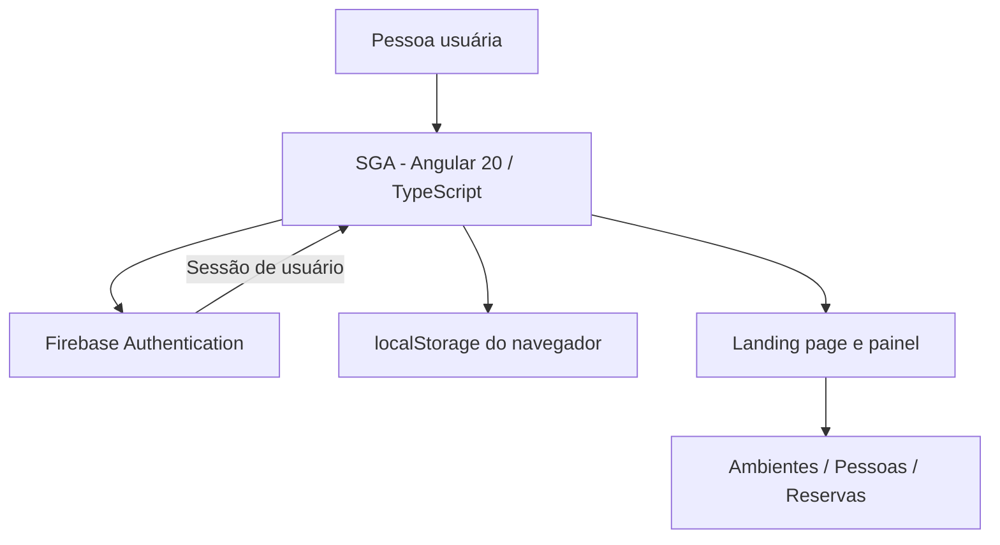
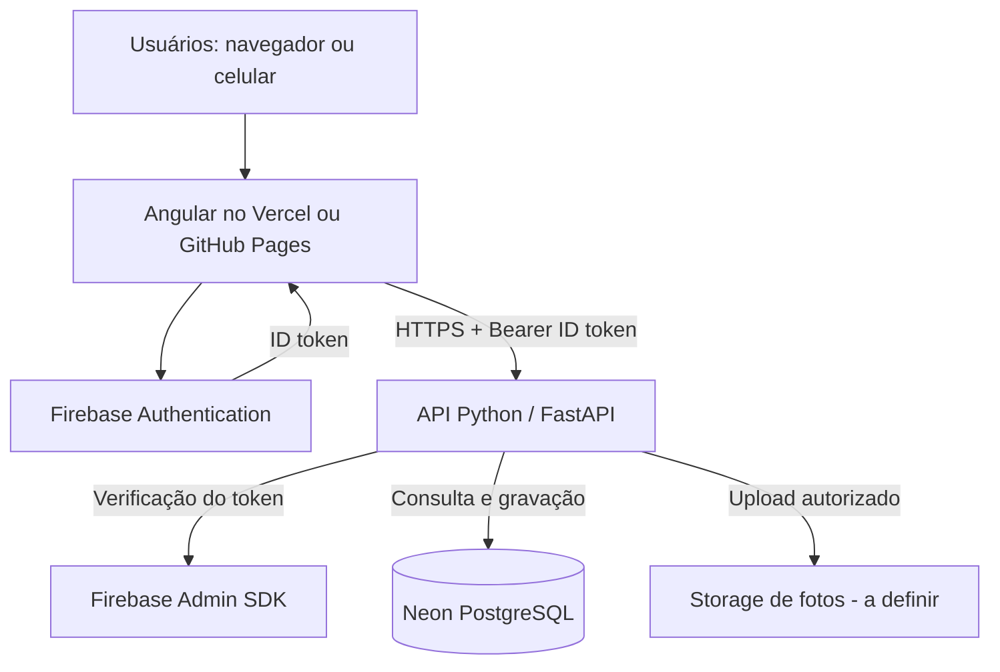

# Arquitetura do SGA — Sistema de Gestão de Ambiente

> **Responsável pela arquitetura:** **Gabrielle Preis**  
> **Engenharia:** **Thiago Ferreira de Oliveira** e **Gabriel Balbino Malaquias**  
> **Versão do documento:** 1.0 — 05/11/2026  
> **Status:** arquitetura atual documentada; integração de backend e banco planejada.

## 1. Visão do produto

O **SGA** é uma aplicação web de gestão de ambientes para escolas, empresas e equipes. Foi concebida para permitir o cadastro de espaços e pessoas, bem como o agendamento de reservas, com uma experiência visual clara, responsiva e de uso simples. O projeto possui identidade visual própria em preto e branco.

## 2. Responsabilidades da equipe

| Integrante | Papel no projeto | Responsabilidade |
| --- | --- | --- |
| **Gabrielle Preis** | **Arquiteta do sistema** | Arquitetura e organização da solução. |
| **Thiago Ferreira de Oliveira** | **Engenheiro de Software — Frontend e autenticação** | Desenvolvimento da interface Angular, experiência do usuário, responsividade, animações e integração do login com Firebase Authentication. |
| **Gabriel Balbino Malaquias** | **Engenheiro de Software — Backend** | Responsabilidade pelo desenvolvimento do backend e de suas regras de negócio e integrações. |

> As atribuições acima são os créditos do projeto. Não significam que as partes futuras (API e integração Neon) já estejam publicadas.

## 3. Arquitetura existente



**Implementado no código-base desta entrega:**

- Frontend Angular 20, TypeScript, HTML e CSS, em aplicação standalone.
- Landing page institucional e painel com visão geral, ambientes, pessoas e reservas.
- Temas claro e escuro, animações e layout adaptável a diferentes tamanhos de tela.
- Login/cadastro por e-mail e senha, login com Google, recuperação de senha e logout pelo Firebase Authentication.
- Nome do usuário exibido a partir do `displayName` do Firebase (com fallback).
- Cadastro de conta com nome completo e entrada de data de nascimento. **A data de nascimento é validada mas não é persistida.**
- Registros de ambientes, pessoas, fotos e reservas persistidos **somente no `localStorage` daquele navegador**, com chave separada por UID Firebase.
- Verificação de conflitos de reservas **somente no cliente**: ainda não substitui validação transacional no servidor.

**Limitações atuais:** dados não são compartilhados entre dispositivos, permissões administrativas não são validadas no servidor, não há API em execução neste pacote e o banco Neon ainda não está conectado.

## 4. Arquitetura planejada para produção



O **Vercel** será o site principal e o **GitHub Pages** poderá servir uma versão estática alternativa do mesmo frontend. Ambos devem utilizar a **mesma API segura**; nenhuma das duas hospedagens deve acessar o Neon diretamente do navegador.

## 5. Componentes e tecnologias

| Camada | Tecnologia | Estado |
| --- | --- | --- |
| Interface e navegação | Angular 20, TypeScript, HTML e CSS | Implementada; requer testes finais |
| Autenticação | Firebase Authentication, Google e e-mail/senha | Implementada no frontend; depende da configuração do projeto Firebase |
| Dados de gestão | `localStorage` | Temporário e local |
| API e autorização | Python/FastAPI | Planejada, sob responsabilidade do backend |
| Banco de dados | Neon PostgreSQL | Schema inicial proposto; ainda sem integração |
| Deploy principal | Vercel | Configuração de deploy presente; publicação não verificada |
| Deploy alternativo | GitHub Pages via GitHub Actions | Workflow presente; publicação não verificada |

## 6. Modelo de domínio

- **Usuário da aplicação:** identidade autenticada pelo Firebase (`firebase_uid`, nome exibido); permissões ainda a implementar.
- **Ambiente:** nome, localização, categoria/tipo, capacidade e identificador.
- **Pessoa:** nome, função, e-mail e foto opcional; pode representar professor, colaborador ou responsável.
- **Reserva:** nome do ambiente informado pelo coordenador, pessoa responsável, título, início e fim. O banco proposto trabalha com relacionamento por `space_id`: a API deverá resolver esse nome para um ambiente cadastrado ou definir formalmente a regra de criação antes do agendamento.

O arquivo [`../database/schema-inicial.sql`](../database/schema-inicial.sql) é **proposta inicial**, não uma migração validada para produção. A arquitetura definitiva deverá definir organização, escopo de dados e estratégia contra reservas simultâneas.

## 7. Regras de negócio previstas

1. Usuário autenticado pode acessar o painel somente conforme suas permissões definidas pelo servidor.
2. Coordenador/administrador poderá criar e editar ambientes e pessoas; permissões de demais papéis serão definidas com a equipe.
3. Reservas precisam ter data inicial anterior à final.
4. Reservas para a mesma sala **ou** pessoa em horários sobrepostos não podem ser confirmadas; no backend, a checagem precisa ser atômica para evitar concorrência.
5. Exclusões com vínculos devem ser tratadas explicitamente para não gerar referências órfãs.
6. Dados de organizações distintas devem ser isolados pelo backend.

## 8. Interfaces da API — proposta, não implementação

| Método | Rota | Finalidade |
| --- | --- | --- |
| GET | `/api/me` | Perfil e autorização do usuário |
| GET, POST | `/api/spaces` | Consultar e criar ambientes |
| PATCH, DELETE | `/api/spaces/{id}` | Editar e remover ambiente |
| GET, POST | `/api/people` | Consultar e criar pessoas |
| PATCH, DELETE | `/api/people/{id}` | Editar e remover pessoa |
| GET, POST | `/api/bookings` | Listar e registrar reservas |
| PATCH, DELETE | `/api/bookings/{id}` | Ajustar e cancelar reservas |

As requisições autenticadas deverão enviar `Authorization: Bearer <Firebase ID token>`. O backend validará o token com o Firebase Admin SDK e aplicará autorização por papel e organização.

## 9. Segurança, privacidade e limites

- **Não** armazenar conexão Neon ou credenciais privadas do Firebase no bundle Angular.
- A configuração Web pública do Firebase deve ser separada de credenciais de serviço; sua presença no cliente **não concede autorização de backend**.
- Fotos pessoais e data de nascimento exigem finalidade explícita, armazenamento adequado, controles de acesso e política de retenção antes de produção.
- Regras de autorização, validação de entrada, auditoria e limites de requisição pertencem à API.
- Não apresentar dados do navegador como “sincronizados em tempo real”.
- Testar acessibilidade, tamanho das animações, `prefers-reduced-motion`, formulários e dispositivos móveis.

## 10. Organização do repositório

```text
SGA-documentado/
├── src/
│   ├── app/
│   │   ├── app.component.ts        # comportamento, páginas e Firebase
│   │   └── app.component.html      # interfaces do sistema
│   ├── styles.css                  # design, responsividade, animações
│   └── main.ts                     # inicialização Angular
├── public/assets/                 # identidade e fotos da equipe
├── database/schema-inicial.sql    # proposta de modelo PostgreSQL
├── scripts/                       # geração da config pública Firebase
├── .github/workflows/pages.yml    # publicação alternativa
├── vercel.json                     # implantação no Vercel
├── DEPLOY.md                       # roteiro de publicação
├── README.md                       # apresentação e início rápido
└── docs/
    ├── ARQUITETURA.md             # este documento
    └── EQUIPE-E-ESCOPO.md          # créditos e escopo atual
```

## 11. Critérios para declarar a primeira versão pronta

- [ ] Compilação e testes do frontend aprovados.
- [ ] Fluxos de login Firebase validados em desenvolvimento e produção.
- [ ] API implementada e protegida por validação de ID token.
- [ ] Papéis e permissões definidos e testados.
- [ ] Persistência PostgreSQL migrada do `localStorage` para a API.
- [ ] Bloqueio de conflitos de reserva garantido no servidor.
- [ ] Testes de integração, segurança, usabilidade e responsividade.
- [ ] Backups, monitoramento, políticas de privacidade e deploy verificados.

## 12. Referências internas

- [README principal](../README.md)
- [Instruções de publicação](../DEPLOY.md)
- [Modelo SQL preliminar](../database/schema-inicial.sql)
- [Equipe e escopo](EQUIPE-E-ESCOPO.md)
